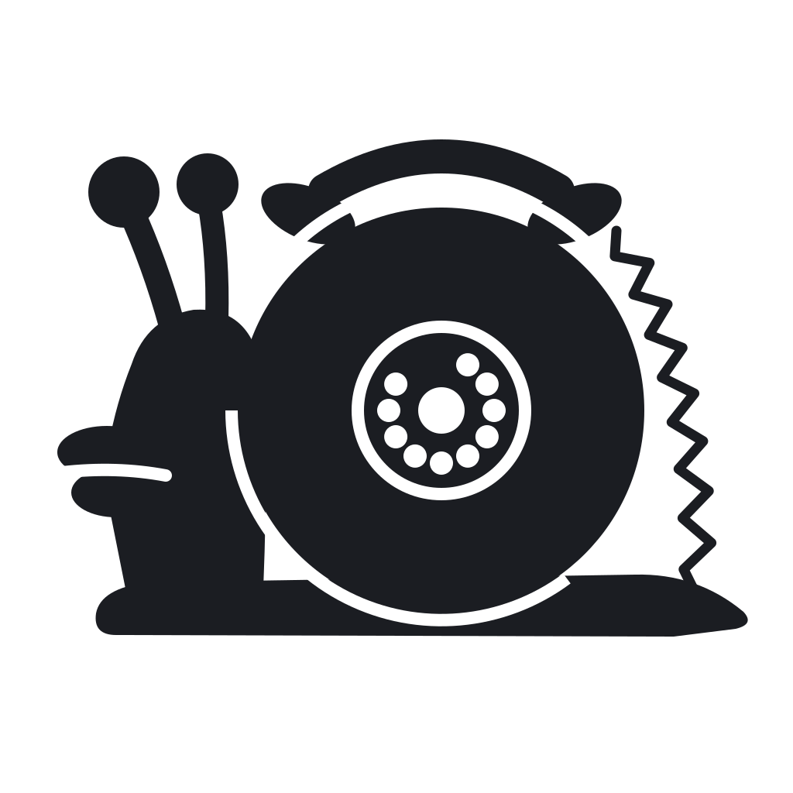

  <picture>
    <source media="(prefers-color-scheme: dark)" srcset="docs/assets/mushi-dark.svg">
    
  </picture>

<h1 align="center">Den Den</h1>

  <b>A computer you run by talking to it.</b> 
  An Arch Linux desktop built for coding agents to live in, with you watching.

  
  
  
  

---

In One Piece, everyone talks through a *den den mushi*, a snail that is also
a phone. This is that idea for a PC: you log in, T3 Code is already open, and
when you want something changed (a shortcut, the taskbar, the boot screen, a
bug in some program) you ask for it and an agent makes the change.

## Why it's different

🐌 **The agent knows the machine.** Every agent gets a map of the whole
system: what runs each part, which file changes it, and the rules. Ask
"make the taskbar smaller" and it knows where to look.

🛟 **Mistakes are cheap to undo.** Btrfs snapshots before and after every
package change, hourly snapshots of your work, and encrypted backups to the
USB stick you installed from. Any snapshot can be booted from the start menu.

🔧 **Every program can be changed from source.** `den src get <pkg>` gives
you the source of whatever is installed as a git repo. Edit it, `den src
build`, and your version stays installed through updates.

🩺 **The machine can answer questions about itself.** `den doctor` reports
on disks, failed services, backups and updates, and agents can ask the same
things over MCP instead of scraping shell output.

✨ **No terminal on the normal path.** You get a boot picker with icons, a
splash screen and a desktop styled after T3 Code, then a setup page that
connects GitHub, Tailscale and backups. You never see a wall of text unless
you go looking.

## What's in the box

| | |
| --- | --- |
| **Base** | Arch + CachyOS repos, `linux-cachyos` (LTS as fallback), Btrfs + snapper |
| **Desktop** | niri tiling, Noctalia shell, Ghostty + fish, Helium browser |
| **Agents** | T3 Code desktop (built from source), Claude Code, Codex |
| **Toolchains** | Node, Bun, Rust, Python (uv), .NET, Docker; `mise` for per-project versions |
| **Network** | Tailscale only, with every other inbound connection refused |
| **Repos** | All your GitHub repos cloned into `~/Projects` and kept up to date |

## Try it

1. **Build** the ISO on any Arch machine: `sudo ./scripts/build.sh`
2. **Flash** it: `scripts/flash.sh out/denden-*.iso /dev/sdX`
3. **Boot** the stick (UEFI), get online, run `denden-install`. It can
   install next to Windows.

Then log in and ask T3 Code for whatever you want changed.

Super+Space opens the launcher, Super+S quick settings, and Super+Shift+/
lists every shortcut.

## Learn more

- [**Building, testing & flashing**](docs/building.md): VM tests, the installer, WSL
- [**Updates, `den` & local source**](docs/updates.md): how packages stay current, the machine API, backups
- [**Design**](docs/agent-environment.md): why it's built this way
- [**Roadmap**](docs/ROADMAP.md): what's done and what's next
- [**The agent contract**](packages/denden-base/AGENTS.md): `AGENTS.md`, the map every agent reads

## License

MIT for original work. `archiso/` is derived from archiso's `releng` profile
and stays [GPL-3.0-or-later](LICENSES/GPL-3.0-or-later.txt).
